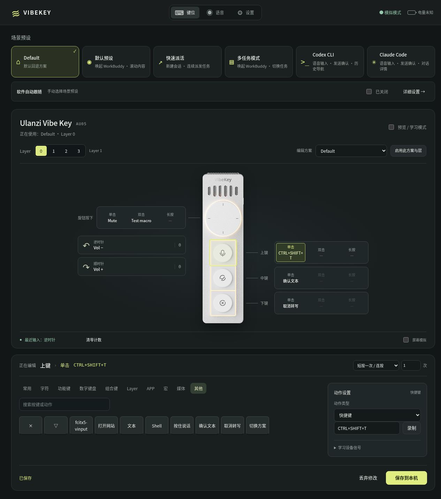

# OpenVibe Key

**OpenVibe Key 是 Ulanzi Studio 的 Linux 版开源实现，为 Ulanzi Vibe Key 提供驱动和设置界面，尽力保留原版的完整功能。**

目前支持 **AU05**，可以设置按键和旋钮、按住说话、切换软件专用键位，以及查看电量和调整灯光。项目由社区独立开发，并非 Ulanzi 官方软件。



[安装](#安装) · [设置按键](#设置按键和旋钮) · [语音输入](#语音输入推荐-fcitx5-vinput) · [自动切换方案](#跟随软件自动切换方案) · [常见问题](#常见问题)

## 能做什么

- **按住说话**：搭配 fcitx5-vinput，把说的话输入聊天框、编辑器或终端。可以使用微信语音识别、离线模型或语音 API。
- **自定义按键和旋钮**：设置快捷键、音量、滚轮、打开软件或网站。同一个按键可以分别设置单击、双击和长按。
- **一个键完成一串操作**：把几个快捷键和等待时间组合起来，按一次就依次执行，也就是通常说的“宏”。
- **为不同用途保存方案**：自带 WorkBuddy 默认、快速派活、多任务，以及 Codex CLI、Claude Code 五套预设，也可以修改或新建自己的方案。
- **跟随软件切换键位**：切到指定软件时用它的专用方案，离开后回到常用方案。
- **准备多组键位**：每个方案有四组键位，对应界面中的 Layer 0–3，可以随时切换。
- **查看电量、调整灯光**：支持全亮、全灭、工作模式，以及全亮模式的亮度调节。
- **备份设置**：可以导出、导入配置，换电脑时继续使用。

目前已在 **Ubuntu 20.04.6、GNOME X11 桌面**上使用和测试。其他系统版本仍需验证；软件自动跟随目前支持 X11。固件升级、设备内保存键位，以及工作模式下自定义状态颜色和呼吸效果尚未支持。

## 安装

### 1. 安装驱动

在 `.deb` 安装包所在文件夹打开终端，执行：

```sh
sudo apt install ./vibekey_0.2.0_all.deb
sudo usermod -aG vibekey-input "$USER"
```

第二条命令让当前账号获得操作设备所需的权限。

<details>
<summary>下载的是源码文件夹，没有 .deb 安装包？</summary>

在包含本 README 的文件夹打开终端，先运行：

```sh
sh scripts/build-deb.sh
```

生成的安装包在 `dist` 文件夹中。进入该文件夹，再按上面的步骤安装。

</details>

### 2. 重新登录并连接设备

**安装后请注销桌面、重新登录，再拔插 Vibe Key 接收器并打开设备。** 仅关闭终端或锁屏不能代替注销。

### 3. 打开设置界面

在应用菜单打开 **VibeKey**（当前菜单名称），或执行：

```sh
vibekey-open
```

设置界面会在浏览器中打开，地址是 <http://127.0.0.1:8765>。以后登录桌面时，驱动会自动运行；关闭设置网页后，按键仍能使用。

语音输入需要另外安装 Fcitx5 和 fcitx5-vinput，步骤见下文。

## 设置按键和旋钮

1. 在首页选择一套场景预设。**点击预设卡片就会保存并启用它**，正在使用的方案会高亮。
2. 点击设备图上的按键，或旁边的单击、双击、长按框。
3. 从下方选择要执行的动作，例如快捷键、音量、打开软件或网站。
4. 按需要修改动作内容，再点击「保存到本机」。

要让按键一直按住某个快捷键，选择「保持按住」；松开实体按键时，快捷键也会松开。语音输入就使用这种方式。

需要不同的键位时，可以切换 Layer 0–3。**方案下拉框和 Layer 标签用于选择要编辑的内容**；如果这套方案或这一层尚未启用，还需点击「启用此方案与层」。

### 按键对应不对，或者旋钮方向反了？

设备之前的设置可能不同，可以重新识别：

1. 开启「预览 / 学习模式」。
2. 在界面中选中要设置的按键，再按一下对应的实体按键。
3. 展开「学习设备信号」，点击「映射到当前控件」。
4. 逐个设置需要修正的按键或旋转方向，保存后关闭预览。

预览模式下只显示收到的按键，不执行你设置的动作。旋钮方向可通过「最近输入」和两边的计数确认。

## 语音输入：推荐 fcitx5-vinput

推荐使用 [fcitx5-vinput](https://github.com/xifan2333/fcitx5-vinput)。配好后，点击想输入文字的位置，**按住 Vibe Key 上键说话，松开后等待文字出现**。

### 1. 安装并设置输入法

先安装 **Fcitx5 输入法**和 **fcitx5-vinput**，并让目标应用使用 Fcitx5。

- **Ubuntu 24.04**：可按 [详细安装步骤](docs/advanced-setup.md#1-安装-fcitx5-与-vinput)安装。
- **Ubuntu 20.04**：需要使用兼容方案，见 [20.04 安装记录](docs/fcitx5-vinput.md)。不要直接套用 24.04 的安装源。
- 其他发行版请看 [fcitx5-vinput 安装说明](https://xifan2333.github.io/fcitx5-vinput/install/)。

在 Fcitx5 的 Vinput 插件设置中，把触发键设为 **右 Alt（Alt_R）**，触发模式设为 **Hold / 按住**。在 Vinput 设置窗口的「控制」页选择麦克风，可以用 AU05，也可以用电脑自己的麦克风。

先在文本框中直接按住右 Alt 说一句话，确认能输入文字，再设置 Vibe Key。

### 2. 选择语音识别方式

打开 **Vinput GUI**，选择适合自己的方式：

| 方式 | 怎样设置 |
| --- | --- |
| **微信输入法 WeType** | 在「资源 → ASR 提供商」安装 WeType，再到「控制」页选择它。本机已使用并确认效果良好。 |
| **离线识别** | 安装 vinput 完整版（Full），在「资源 → 模型」下载并启用中文模型。下载完成后可离线使用。 |
| **语音 API** | 安装对应的识别服务，在「控制」页填写该服务要求的网址、模型和密钥。支持 OpenAI 兼容语音接口。 |

这里的“微信输入法”是 vinput 中可选的语音识别服务，文字仍通过 Fcitx5 输入。它需要联网，录音会发送到微信输入法的识别服务，采用的是非官方接口。API 识别同样需要联网；希望完全离线使用时，选择本地模型和「原始」场景。

建议先选「原始」场景，直接使用识别结果。需要翻译或改写时，再开启文字整理功能。密钥只在自己的 vinput 设置中填写。

### 3. 绑定 Vibe Key 上键

回到 VibeKey 设置界面：

1. 点击上键的「单击」框。
2. 在「其他」中选择 **fcitx5-vinput**。
3. 确认快捷键为 **RIGHTALT**，输出模式为「保持按住」。
4. 保存设置，确认当前方案已启用，并关闭预览模式。
5. 点击目标输入框，按住上键说话，松开后等待识别。

添加其他预设时，勾选「沿用当前方案的语音键」，就能保留这套语音按键设置。

如果改了 vinput 的触发键，也要把驱动里的快捷键改成同一个键。设置页另有一套内置录音功能；使用 fcitx5-vinput 时，录音设备和识别方式都在 **Vinput GUI** 中设置即可。

## 跟随软件自动切换方案

例如，切到 Codex 时使用 Codex 键位，切回其他软件时恢复平时的语音和音量键位。

1. 在首页「软件自动跟随」旁点击「详细设置」。
2. 选择一个默认方案，供未绑定的软件使用。
3. 点击「刷新应用窗口」，选择已打开的软件，点击「绑定所选窗口」。
4. 为它选择方案和 Layer，开启自动跟随，再保存到本机。

首页可以直接开关自动跟随。**手动点击场景预设会关闭自动跟随**，避免刚选好的方案又被自动切走；需要时可以重新打开。

### Codex CLI 和 Claude Code

这两套预设的上键为按住说话，中键为发送或确认，下键为取消。旋钮按下分别用于搜索历史、展开对话详情，旋转可上下选择。

在详细设置中点击「添加 CLI 自动跟随」并保存，就会添加这两套方案及对应的应用绑定。

推荐从设置页或应用菜单中的 **Codex CLI (VibeKey)**、**Claude Code (VibeKey)** 启动。也可以在项目文件夹中执行：

```sh
vibekey-codex
```

或者：

```sh
vibekey-claude
```

需要先安装对应 CLI 和 GNOME Terminal。通过这些入口打开，驱动才能稳定区分两个终端窗口；如果使用已有终端，需要按专有窗口标题单独绑定。

## 电量和灯光

电量显示在页面右上角，会定时更新。设备待机时可能无法读取电量，按一下按键唤醒后，再到设置页刷新。

在设置页的「灯效」中选择全亮、全灭或工作模式，调整全亮模式亮度后，点击「应用灯效」。页面会提示设备是否已确认设置。

## 常见问题

**设备连上了，按键却没效果？** 先确认已启用想用的方案，并关闭「预览 / 学习模式」。如果刚安装，请完整注销、重新登录并重插接收器；对应关系不对时，按前面的步骤重新学习。

**语音按键没反应？** 先在目标输入框中直接测试右 Alt。如果也不能识别，检查 Vinput 是否运行、麦克风是否选对；如果右 Alt 正常，再检查 Vibe Key 的快捷键和「保持按住」设置。

**有时整句话没有文字？** 检查麦克风音量。如果声音已经录到，可以在 Vinput 中暂时关闭“语音活动检测（VAD）”对比。本机曾用这个办法解决整句漏识别。

**终端能输入，浏览器或编辑器不能？** 重新打开目标应用；如果仍不行，检查该应用是否已使用 Fcitx5，见 [输入法设置说明](docs/advanced-setup.md#1-安装-fcitx5-与-vinput)。

**怎样备份或换电脑？** 在设置页选择「导出配置」；换电脑后用「导入配置」载入，再保存。语音服务、模型和密钥需要另行配置。

**怎样卸载？** 在终端执行：

```sh
systemctl --user stop vibekey.service
sudo apt remove vibekey
```

个人设置会保留。按 Ubuntu 20.04 兼容方案配置了语音服务的用户，还需按 [安装记录](docs/fcitx5-vinput.md#验证与恢复)停止对应服务。

## 更多说明

- [安装补充与高级设置](docs/advanced-setup.md)
- [软件自动跟随详细说明](docs/auto-follow.md)
- [fcitx5-vinput 官方文档](https://xifan2333.github.io/fcitx5-vinput/)
- [第三方来源与许可](THIRD_PARTY.md)

本项目代码采用 [MIT 许可](LICENSE)。设备插图及其他第三方内容的权利归属见第三方说明。
